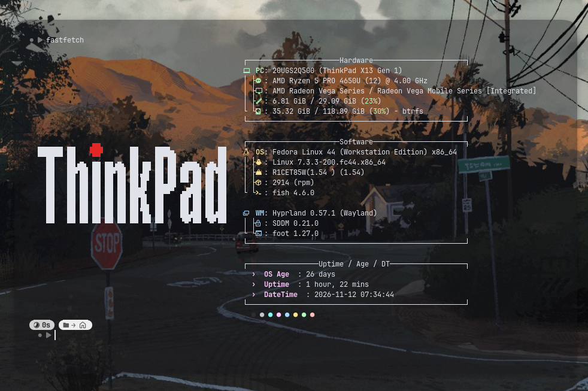

<p align="center">
  
</p>

# ThinkRice

A collection of configurations and assets for linux ricing. This project focuses on terminal appearance, Lenovo/ThinkPad visual identity, and ThinkPad-themed wallpapers.

> Note: Not affiliated with Lenovo/IBM. ThinkPad is a trademark of Lenovo.

## Project contents

| Component     | Description                                             |
| ------------- | ------------------------------------------------------- |
| `fastfetch/`  | Fastfetch configuration and ThinkPad/Lenovo ASCII logos |
| `neofetch/`   | ASCII logos that can be used with Neofetch              |
| `wallpapers/` | Collection of ThinkPad-themed wallpapers                |
| `grub/`        | Collection of GRUB custom configs                      |

## Fastfetch

Fastfetch configuration screenshot;
<p align="center">
  
</p>

Several configurations are available:

- `fastfetch/ascii` - contains ASCII logos that can be called through the
  Neofetch configuration, including several variations of ThinkPad, Lenovo, ThinkCentre, and ThinkServer logos.
- `fastfetch/configs` - several examples of ready-to-use configurations for fastfetch.

The configuration displays information such as device, CPU, GPU, memory, disk, operating system, kernel, shell, desktop environment/window manager, uptime, date, and system installation age.


## Running Fastfetch

If you want to try the configuration, copy the desired configuration to the active configuration location or run it directly from the project directory.

Example:

```bash
fastfetch --config ./configs/thinkpad-vertical.jsonc
```

If a configuration refers to a different logo file name, change the `logo.source` value to match the file available in `~/.config/fastfetch/ascii/`.


### Wallpaper

The `wallpapers/` directory contains ThinkPad-themed PNG wallpapers. Will be added another wallpaper soon.

## Requirements

- Linux or a Unix-like system.
- [Fastfetch](https://github.com/fastfetch-cli/fastfetch) or [Neofetch](https://github.com/dylanaraps/neofetch).
- A Nerd Font so that icons in the terminal output display correctly. (optional)

## Fastfetch Installation

Before installing, you can check [this page](./fastfetch/README.md) first.

### One-liner (recommended)

```bash
curl -fsSL https://raw.githubusercontent.com/aaksaa/thinkrice/main/install.sh | bash
```

Or with wget:

```bash
wget -qO- https://raw.githubusercontent.com/aaksaa/thinkrice/main/install.sh | bash
```

Non-interactive (pick a config by name):

```bash
THINKRICE_CONFIG=thinkpad-vertical.jsonc \
  curl -fsSL https://raw.githubusercontent.com/aaksaa/thinkrice/main/install.sh | bash
```

The script copies the selected config to `~/.config/fastfetch/config.jsonc`
and all ASCII logos to `~/.config/fastfetch/ascii/`. Existing config is
backed up to `~/.config/fastfetch-backup-<timestamp>/`.

Or you can install manually with gitclone, rename the file and copy the file into ~/.config/fastfetch/. Don't forget to renaming the file into config.jsonc.

## Configuration notes

- Some logos use Unicode characters and Nerd Font icons.
- Fastfetch files use the JSONC format, so comments inside them are intentional.
- Fastfetch configurations that use logo paths relative to `~/.config/fastfetch/ascii/` require the ASCII assets to have been copied to that location.
- Wallpapers can be selected through the desktop environment or wallpaper manager you use.

### Neofetch (deprecated)

The `neofetch/ascii/` directory contains ASCII logos that can be called through the Neofetch configuration, including several variations of ThinkPad, Lenovo, ThinkCentre, and ThinkServer logos.

And be added another configs for neofetch.

## Using logos with Neofetch

Add or change the following option in `~/.config/neofetch/config.conf`:

```bash
ascii_custom="$HOME/.config/neofetch/ascii/thinkpad-h.txt"
```

Replace `thinkpad-h.txt` with another logo from the `neofetch/ascii/` directory according to your preference.


## Customization

1. Choose an ASCII logo from `fastfetch/ascii/` or `neofetch/ascii/`.
2. Change `logo.source` in the Fastfetch configuration.
3. Adjust colors, padding, modules, and output format as needed.
4. Choose a wallpaper from `wallpapers/`.

# GRUB Theme

[See the details](./grub/thinkpad/README.md)
Documentation soon.

## Installation via Nix Flake

### Prerequisites
- [Nix](https://nixos.org/) package manager installed.
- [Home Manager](https://github.com/nix-community/home-manager) (optional, but recommended for user-level configs).

### 1. Add as Input

Add `thinkrice` to the `inputs` section of your `flake.nix`:

```nix
{
  inputs = {
    nixpkgs.url = "github:NixOS/nixpkgs/nixos-unstable";
    
    # Add ThinkRice
    thinkrice = {
      url = "github:Aaksaa/thinkrice";
      inputs.nixpkgs.follows = "nixpkgs";
    };
  };
}
```

### 2. Configure Home Manager

Import the module and enable it in your Home Manager configuration:

```nix
{ inputs, ... }:

{
  imports = [
    inputs.thinkrice.homeManagerModules.default
  ];

  programs.thinkrice = {
    enable = true;
    
    # Choose a config from fastfetch/configs/ 
    # e.g., "thinkpad-vertical.jsonc", "thinkpad-horizontal.jsonc"
    configName = "thinkpad-vertical.jsonc";
    
    # Set to true if you still use Neofetch
    enableNeofetch = false;
  };
  
  # Ensure fastfetch is enabled if you haven't already
  programs.fastfetch.enable = true;
}
```

This will automatically:
1. Install the selected `fastfetch` configuration to `~/.config/fastfetch/config.jsonc`.
2. Symlink all ASCII logos to `~/.config/fastfetch/ascii/`.
3. Make wallpapers available in `~/.local/share/wallpapers/thinkrice/`.

### 3. Configure GRUB Theme (NixOS)

To apply the ThinkPad theme to your GRUB bootloader, add the following to your NixOS `configuration.nix` or `hardware-configuration.nix`:

```nix
{ inputs, pkgs, ... }:

{
  boot.loader.grub = {
    enable = true;
    # Point to the theme directory inside the Nix store
    theme = "${inputs.thinkrice.packages.${pkgs.system}.default}/share/thinkrice/grub/thinkpad";
  };
}
```

After rebuilding (`sudo nixos-rebuild switch`), update your GRUB configuration to apply the changes:
```bash
sudo grub-mkconfig -o /boot/grub/grub.cfg
```
### Customization
Fastfetch: Edit ~/.config/fastfetch/config.jsonc or choose a different preset by changing configName in your Nix config.
Wallpapers: Browse ~/.local/share/wallpapers/thinkrice/ and set your preferred image via your desktop environment's settings.
ASCII Logos: Available in ~/.config/fastfetch/ascii/. You can reference them manually in your config using logo.source.

# License

- Main package - **MIT** (see [LICENSE](LICENSE))
- GRUB theme (`grub/thinkpad`) - **GPL-3.0** (see [grub/thinkpad/LICENSE](grub/thinkpad/LICENSE))

> The GRUB theme is a separate component derived from [distro-grub-themes](https://github.com/AdisonCavani/distro-grub-themes) and does not affect the license of the main package.